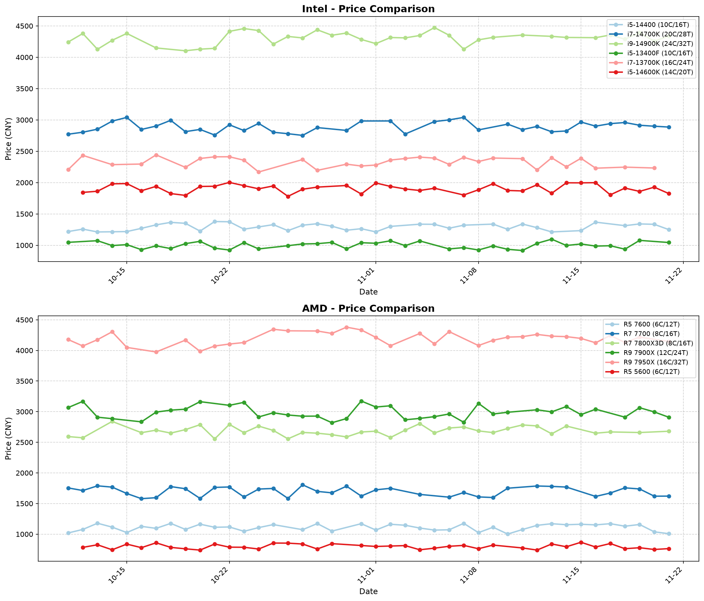
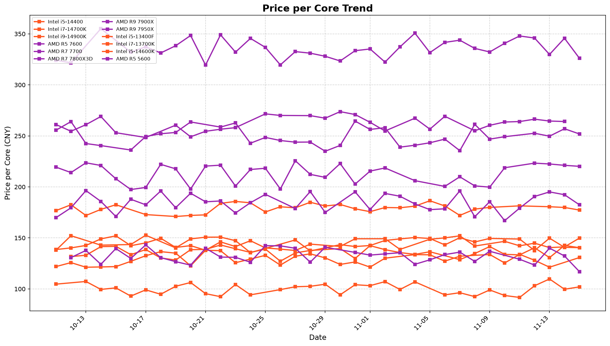

# 📊 京东 CPU 价格监控

自动追踪京东 CPU 价格变化，每日更新两次。

## 📈 产品价格

| 产品 | 核心/线程 | 当前价格 | 有货 |
|------|-----------|----------|------|
| Intel i5-14400 | 10核16线程 | ¥1236.10 | ✅ |
| Intel i5-14600K | 14核20线程 | ¥1955.74 | ✅ |
| Intel i7-14700K | 20核28线程 | ¥2873.14 | ✅ |
| Intel i9-14900K | 24核32线程 | ¥4308.80 | ✅ |
| AMD R5 7600 | 6核12线程 | ¥1126.20 | ✅ |
| AMD R7 7700 | 8核16线程 | ¥1792.55 | ✅ |
| AMD R7 7800X3D | 8核16线程 | ¥2626.35 | ✅ |
| AMD R9 7900X | 12核24线程 | ¥3038.92 | ✅ |
| AMD R9 7950X | 16核32线程 | ¥4218.17 | ✅ |
| Intel i5-13400F | 10核16线程 | ¥1021.32 | ✅ |
| Intel i7-13700K | 16核24线程 | ¥2226.36 | ✅ |
| AMD R5 5600 | 6核12线程 | ¥873.21 | ✅ |

---

## 📊 价格趋势图

### 产品价格对比

### 每核心价格趋势

---

## 🔄 自动更新

每天北京时间 10:00 和 20:00 自动更新价格。

## 📁 数据格式

历史数据存储在 `data/YYYY-MM-DD.json` 文件中。

---

*数据仅供参考，以京东实际价格为准*